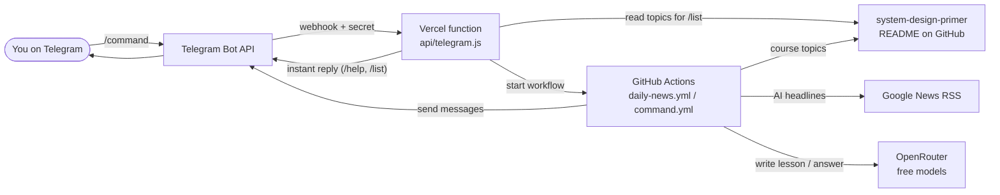
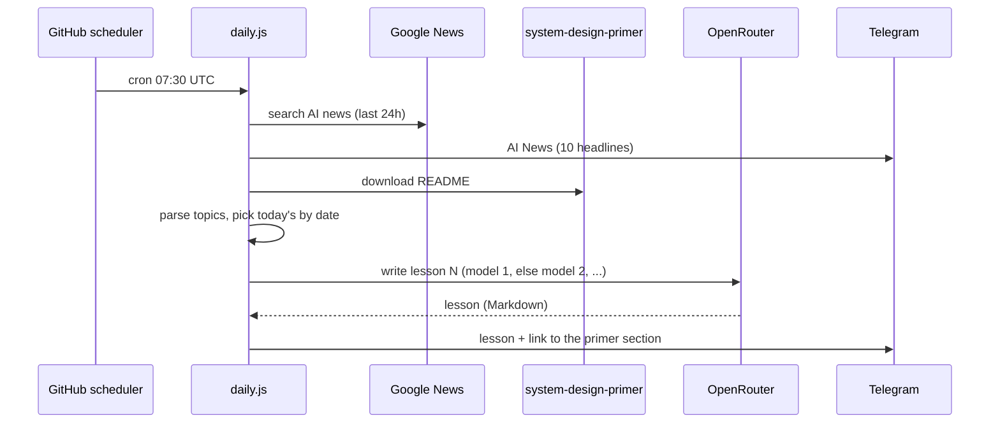
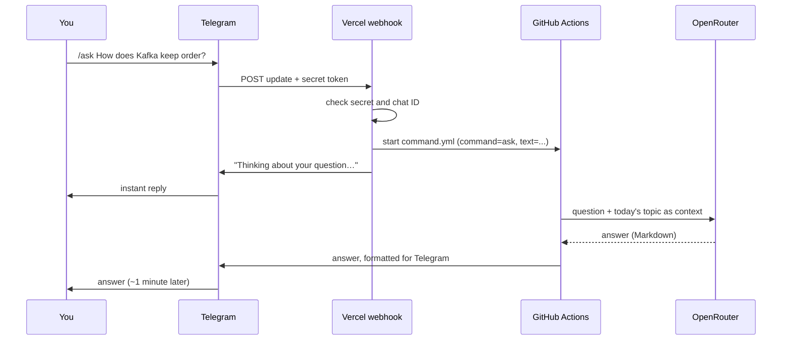

# Hermes AI — High-Level Design

Hermes is a personal Telegram bot that sends a daily **AI news digest** and a daily **system design lesson**, and answers commands typed in Telegram.

Design principles:

- **No server to manage**: GitHub Actions does the work, a Vercel function receives Telegram messages.
- **No hard-coded data**: course topics are downloaded live from the internet; settings come from environment variables.
- **Nothing stored**: news and lessons are generated fresh and only sent to Telegram. There is no database and the repo is never written to.
- **Free to run**: free AI models through OpenRouter, with automatic fallback between models.

---

## 1. Goals

| Goal | How it is met |
|---|---|
| AI news every day at 1:00 PM IST | Scheduled GitHub Actions workflow + Google News RSS |
| One in-depth system design lesson per day, beginner → intermediate | Topics from system-design-primer, picked by date, lesson written by AI |
| Control the bot from Telegram | Telegram webhook → Vercel → GitHub Actions |
| No hard-coded topics or settings | Topics fetched live; every setting overridable via environment variables |
| No stored data | Everything is computed per request; the topic for a day is derived from the date |
| Free | GitHub Actions, Vercel Hobby and free OpenRouter models |

---

## 2. Architecture



### Components

| Component | Where it runs | Responsibility |
|---|---|---|
| **Telegram Bot API** | Telegram | Delivers your messages to the webhook; shows the bot's replies |
| **Webhook** — `api/telegram.js` | Vercel (serverless) | Verifies the request, answers instant commands, starts the GitHub workflow for slow ones |
| **Daily job** — `daily.js` | GitHub Actions, cron `30 7 * * *` (1:00 PM IST) | Sends AI news + today's lesson |
| **Command job** — `command.js` | GitHub Actions, started by the webhook | Runs one command: news, lesson, next, topic, ask, list |
| **Webhook setup** — `setup-webhook.yml` | GitHub Actions, run manually | Registers the webhook URL, secret and `/` command menu with Telegram |
| **Topic source** — `lib/topics.js` | Downloads at runtime | Parses system-design-primer's headings into an ordered course |
| **AI** — `lib/ai.js` | OpenRouter API | Writes lessons and answers questions, trying models in order |

**Why split Vercel and GitHub Actions?** Telegram expects a webhook to answer within seconds, but writing a lesson takes 1–2 minutes. Vercel replies immediately ("Writing today's lesson…") and hands the slow work to GitHub Actions, which has no short time limit.

---

## 3. Flows

### 3.1 Daily run (1:00 PM IST)



News and lesson run independently: if one fails, the other still runs, and the failure is reported in Telegram with a ⚠️ message.

### 3.2 Slow command (`/news`, `/lesson`, `/next`, `/topic`, `/ask`)



### 3.3 Instant command (`/help`, `/list`)

Vercel answers directly. For `/list` it downloads the topic list and marks today's position.

### Commands

| Command | Handled by | Uses AI |
|---|---|---|
| `/help`, `/start` | Vercel | No |
| `/list` | Vercel | No |
| `/news` | GitHub Actions | No |
| `/lesson` (today's topic) | GitHub Actions | Yes |
| `/next` (tomorrow's topic) | GitHub Actions | Yes |
| `/topic <name>` | GitHub Actions | Yes |
| `/ask <question>` | GitHub Actions | Yes |

---

## 4. Course without storage

The course needs no saved progress because the topic is a pure function of the date:

```
dayNumber   = days between COURSE_START_DATE and today (IST)
topicIndex  = dayNumber mod numberOfTopics
```

- Everyone running the same settings on the same day gets the same topic, on GitHub and on Vercel.
- `/next` uses `dayNumber + 1`.
- After the last topic the course starts again from the first.

**Topic parsing** (`lib/topics.js`): the primer README is downloaded and its headings are read in order.

- Sections from *Performance vs scalability* up to *Appendix* become fundamentals, with sub-headings named like `Cache: Write-through`.
- The *System design interview questions with solutions* section becomes the case studies at the end.
- Headings such as *Source(s) and further reading* or *Disadvantage(s)* are skipped.
- Each topic keeps a link to its section on GitHub, added to the end of the lesson.

If another source is configured and these sections are not found, every heading is used as a topic.

---

## 5. Security

| Risk | Protection |
|---|---|
| Someone else calls the webhook | Telegram sends a secret header (`TELEGRAM_WEBHOOK_SECRET`); requests without it get `401` |
| Someone else messages the bot | Only messages from `TELEGRAM_CHAT_ID` are handled; all others are ignored |
| Secrets leaking | Tokens live only in GitHub Secrets and Vercel environment variables, never in code |
| Command text injected into shell | Workflow inputs are passed as environment variables, not inserted into shell commands |
| Workflows changing the repo | Workflows have `contents: read` only |
| GitHub token too powerful | Fine-grained token limited to this repo with Actions read/write only |

---

## 6. Reliability

| Situation | Behaviour |
|---|---|
| A free model is rate-limited, busy or returns nothing | The next model in `AI_MODELS` is tried; the error lists every model's failure if all fail |
| A model includes `<think>` reasoning in its reply | Removed before sending |
| Telegram rejects the formatting | The message is re-sent as plain text |
| Message longer than Telegram's limit | Split into several messages, never inside a code block |
| Topic source unreachable | ⚠️ "Could not download the topic list"; `/ask` and `/topic` still work without context |
| Something fails | A ⚠️ message in Telegram explains what went wrong |
| Webhook settings incomplete | `GET /api/telegram` lists missing Vercel variables; `setup-webhook` stops if a secret is missing |

---

## 7. Configuration

**Secrets**

| Name | GitHub Secrets | Vercel env vars | Purpose |
|---|:---:|:---:|---|
| `TELEGRAM_BOT_TOKEN` | ✅ | ✅ | Send messages as the bot |
| `TELEGRAM_CHAT_ID` | ✅ | ✅ | Your chat; the only one the bot talks to |
| `TELEGRAM_WEBHOOK_SECRET` | ✅ | ✅ | Proves requests come from Telegram (same value in both) |
| `OPENROUTER_API_KEY` | ✅ | | AI models |
| `GITHUB_TOKEN` | | ✅ | Lets Vercel start `command.yml` |
| `GITHUB_REPO` | | ✅ | `owner/repo` |

**Settings** (GitHub Variables; optional, all have defaults in `lib/config.js`)

`AI_MODELS`, `AI_LESSON_MAX_TOKENS`, `AI_ANSWER_MAX_TOKENS`, `NEWS_QUERY`, `NEWS_COUNT`, `TOPICS_SOURCE_URL`, `COURSE_START_DATE`. The last two are also read by Vercel for `/list`.

---

## 8. Code map

```
daily.js              Entry: daily news + lesson
command.js            Entry: run one Telegram command on GitHub Actions
api/telegram.js       Entry: Vercel webhook

lib/
  config.js           Settings from environment variables, with defaults
  commands.js         Command list, parsing and help text
  news.js             Fetch and send AI news
  topics.js           Download and parse the course topics
  course.js           Topic for a date, the /list message
  lessons.js          Today's / tomorrow's / custom lessons, questions
  ai.js               OpenRouter calls with model fallback
  prompts.js          Instructions given to the AI
  telegram.js         Send messages, Markdown and error alerts
  markdown.js         Markdown → Telegram HTML, split long messages
  github.js           Start the command workflow (used by Vercel)
  dates.js, html.js   Small helpers
```

---

## 9. Trade-offs and limits

| Choice | Benefit | Cost |
|---|---|---|
| GitHub Actions instead of a server | Free, no machine to keep running | Slow commands take ~1 minute; scheduled runs can start a few minutes late |
| No storage | Nothing to manage or clean up; no commits | `/lesson` writes the lesson again each time; news can repeat across days; no lesson archive |
| Topic by date | No saved progress needed | Missing a day skips that topic (read it later with `/topic`); can't "complete" lessons out of order |
| Topics from system-design-primer | Always up to date, well-known structure | Depends on that README's heading layout; a few topics are small sub-sections |
| Free OpenRouter models | No cost | Rate limits, variable quality and availability |
| Single chat ID | Simple and safe | Only one person can use the bot |

---

## 10. Extending

**Add a command**, for example `/quiz`:

1. Add `quiz: { description, workingReply }` to `COMMANDS` in `lib/commands.js`.
2. Add `quiz: () => ...` to `HANDLERS` in `command.js`.
3. Add it to the menu in `setup-webhook.yml` and re-run that workflow.

**Use a different topic source:** set `TOPICS_SOURCE_URL` (GitHub and Vercel). Any Markdown page with `##`/`###` headings works.

**Use a better model:** set `AI_MODELS`, e.g. `anthropic/claude-sonnet-5.5,openrouter/free`, and add OpenRouter credits.
