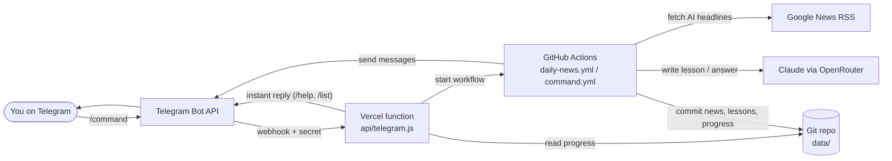
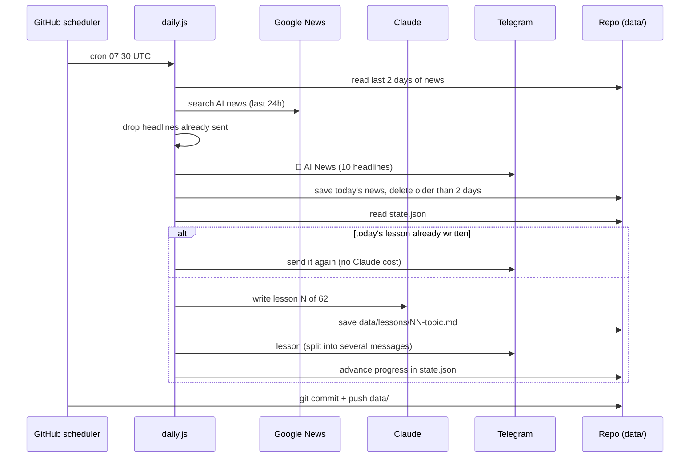
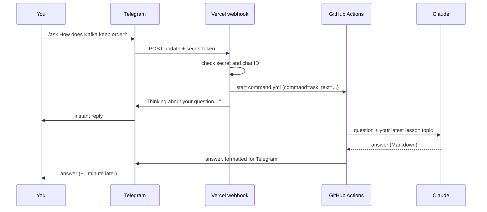

# Hermes AI — High-Level Design

Hermes is a personal Telegram bot that sends a daily **AI news digest** and a daily **system design lesson** (written by Claude), and answers commands typed in Telegram.

It runs with **no server to manage** and no database. GitHub Actions does the work, a Vercel function receives Telegram messages, and the Git repository itself stores all data.

---

## 1. Goals

| Goal | How it is met |
|---|---|
| AI news every day at 1:00 PM IST | Scheduled GitHub Actions workflow |
| One in-depth system design lesson per day, beginner → intermediate | 62-topic course, lesson written by Claude |
| Control the bot from Telegram (`/news`, `/next`, `/ask` …) | Telegram webhook → Vercel → GitHub Actions |
| No repeated headlines, no unbounded storage | Only the last 2 days of news are kept and used for de-duplication |
| Keep lessons for later reading | Every lesson saved as Markdown in the repo |
| Free to host | GitHub Actions + Vercel Hobby; only Claude usage is paid |

---

## 2. Architecture



### Components

| Component | Where it runs | Responsibility |
|---|---|---|
| **Telegram Bot API** | Telegram | Delivers your messages to the webhook; shows the bot's replies |
| **Webhook** — `api/telegram.js` | Vercel (serverless) | Verifies the request, answers instant commands, starts the GitHub workflow for slow ones |
| **Daily job** — `daily.js` | GitHub Actions, cron `30 7 * * *` (1:00 PM IST) | Sends AI news + today's lesson |
| **Command job** — `command.js` | GitHub Actions, started by the webhook | Runs one command: news, lesson, next, topic, ask, list |
| **Webhook setup** — `setup-webhook.yml` | GitHub Actions, run manually | Registers the webhook URL, secret and `/` command menu with Telegram |
| **Claude** — `lib/claude.js` | OpenRouter API (`anthropic/claude-opus-5.5`) | Writes lessons and answers questions |
| **Storage** — `data/` | Git repository | News, lessons and course progress |

**Why split Vercel and GitHub Actions?** Telegram expects a webhook to answer within seconds, but writing a lesson with Claude takes 1–2 minutes. Vercel replies immediately ("Writing your next lesson…") and hands the slow work to GitHub Actions, which has no short time limit and can commit files back to the repo.

---

## 3. Flows

### 3.1 Daily run (1:00 PM IST)



News and lesson run independently: if one fails, the other still runs, and the failure is reported in Telegram with a ⚠️ message.

### 3.2 Slow command (`/news`, `/lesson`, `/next`, `/topic`, `/ask`)



### 3.3 Instant command (`/help`, `/list`)

Vercel answers directly without starting GitHub Actions. `/list` reads `data/state.json` from GitHub through the API to show which lessons are done.

### Commands

| Command | Handled by | Uses Claude | Changes progress |
|---|---|---|---|
| `/help`, `/start` | Vercel | No | No |
| `/list` | Vercel | No | No |
| `/news` | GitHub Actions | No | No |
| `/lesson` | GitHub Actions | Only if no lesson exists yet | No |
| `/next` | GitHub Actions | Yes | Yes, moves to the next topic |
| `/topic <name>` | GitHub Actions | Yes | No (saved as a custom lesson) |
| `/ask <question>` | GitHub Actions | Yes | No |

---

## 4. Data model

All data lives in the repo under `data/` and is committed by the workflows.

```
data/
├── news/
│   ├── 2026-11-19.json     headlines sent that day (only the last 2 days are kept)
│   └── 2026-11-20.json
├── lessons/
│   ├── 01-what-happens-when-you-type-a-url....md
│   ├── 02-dns-how-domain-names-are-resolved.md
│   └── custom-2026-11-20-kafka-consumer-groups.md
└── state.json              course progress
```

**`state.json`**

```json
{
  "nextTopicIndex": 3,
  "latestTopic": "Client-server model, HTTP and HTTPS (TLS handshake)",
  "latestLessonFile": "03-client-server-model-http-and-https-tls-handshake.md",
  "dailyLessonDate": "2026-11-20"
}
```

| Field | Meaning |
|---|---|
| `nextTopicIndex` | Position in the 62-topic course; wraps back to lesson 1 after the last topic |
| `latestTopic` | Given to Claude so lessons and answers can build on the previous one |
| `latestLessonFile` | What `/lesson` re-sends |
| `dailyLessonDate` | Day the scheduled lesson was written; prevents paying twice if the daily job is re-run. `/next` does not change it, so the 1 PM lesson still arrives |

---

## 5. Security

| Risk | Protection |
|---|---|
| Someone else calls the webhook | Telegram sends a secret header (`TELEGRAM_WEBHOOK_SECRET`); requests without it get `401` |
| Someone else messages the bot and spends Claude credits | Only messages from `TELEGRAM_CHAT_ID` are handled; all others are ignored |
| Secrets leaking | Tokens live only in GitHub Secrets and Vercel environment variables, never in code |
| Command text injected into shell | Workflow inputs are passed as environment variables, not inserted into shell commands |
| GitHub token too powerful | Fine-grained token limited to this repo: Actions read/write, Contents read-only |

---

## 6. Reliability

| Situation | Behaviour |
|---|---|
| Daily job re-run on the same day | Re-sends today's lesson instead of writing a new one |
| Two commands at the same time | Both run; the commit step pulls and retries the push up to 5 times |
| Claude declines or fails a request | The error is reported in Telegram; the command can simply be sent again |
| Telegram rejects the formatting | The message is re-sent as plain text |
| Lesson longer than Telegram's 4096-character limit | Split into several messages, never inside a code block |
| Something fails | A ⚠️ message in Telegram explains what went wrong, e.g. "GITHUB_TOKEN in Vercel is wrong or expired" |
| Webhook settings incomplete | `GET /api/telegram` lists missing Vercel variables; `setup-webhook` stops if a secret is missing |

---

## 7. Configuration

| Name | GitHub Secrets | Vercel env vars | Purpose |
|---|:---:|:---:|---|
| `TELEGRAM_BOT_TOKEN` | ✅ | ✅ | Send messages as the bot |
| `TELEGRAM_CHAT_ID` | ✅ | ✅ | Your chat; the only one the bot talks to |
| `TELEGRAM_WEBHOOK_SECRET` | ✅ | ✅ | Proves requests come from Telegram (same value in both) |
| `OPENROUTER_API_KEY` | ✅ | | Claude via OpenRouter |
| `GITHUB_TOKEN` | | ✅ | Lets Vercel start `command.yml` and read progress |
| `GITHUB_REPO` | | ✅ | `owner/repo`, e.g. `GOURAVSINGH19/Hermes-AI` |

Tunable settings (model, effort, headlines per message, days of news to keep) are in `lib/config.js`. The course topics are in `lib/topics.js`.

---

## 8. Code map

```
daily.js              Entry: daily news + lesson
command.js            Entry: run one Telegram command on GitHub Actions
api/telegram.js       Entry: Vercel webhook

lib/
  config.js           Settings and file paths
  commands.js         Command list, parsing and help text
  news.js             Fetch, de-duplicate, send and clean up AI news
  lessons.js          Daily / next / custom lessons, questions, progress
  claude.js           Calls Claude through OpenRouter
  prompts.js          Instructions given to Claude
  telegram.js         Send messages, Markdown and error alerts
  markdown.js         Markdown → Telegram HTML, split long messages
  github.js           Start the command workflow, read progress (used by Vercel)
  state.js            Read and save state.json
  progress.js         The /list message
  topics.js           The 62 course topics
  dates.js, html.js   Small helpers

.github/workflows/
  daily-news.yml      Scheduled daily run
  command.yml         Runs one command (started by the webhook)
  setup-webhook.yml   One-time Telegram webhook setup
```

---

## 9. Trade-offs and limits

| Choice | Benefit | Cost |
|---|---|---|
| GitHub Actions instead of a server | Free, no machine to keep running | Slow commands take ~1 minute to start; scheduled runs can start a few minutes late |
| Git repo as storage | No database; lessons readable on GitHub; full history | Every run adds a commit |
| Google News RSS | No API key, always fresh | Headline links go through Google News redirects |
| Claude Opus 5.5 at medium effort, through OpenRouter | High-quality, accurate lessons; one key for many models | Each lesson costs money (logged as tokens in the workflow run) |
| Single chat ID | Simple and safe | Only one person can use the bot |

---

## 10. Extending

**Add a command**, for example `/quiz`:

1. Add `quiz: { description, workingReply }` to `COMMANDS` in `lib/commands.js`.
2. Add `quiz: () => ...` to `HANDLERS` in `command.js`.
3. Add it to the menu in `setup-webhook.yml` and re-run that workflow.

**Change the course:** edit the list in `lib/topics.js`. Progress continues from the current position.

**Change the news topic:** edit `news.searchQuery` in `lib/config.js`.
